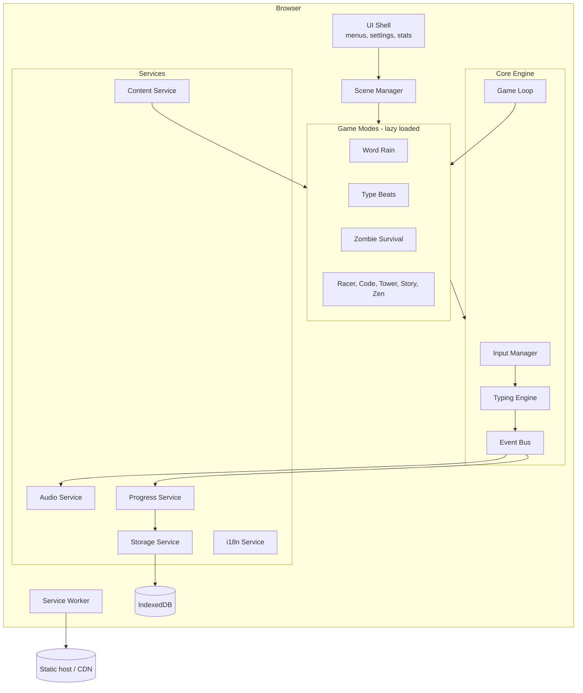
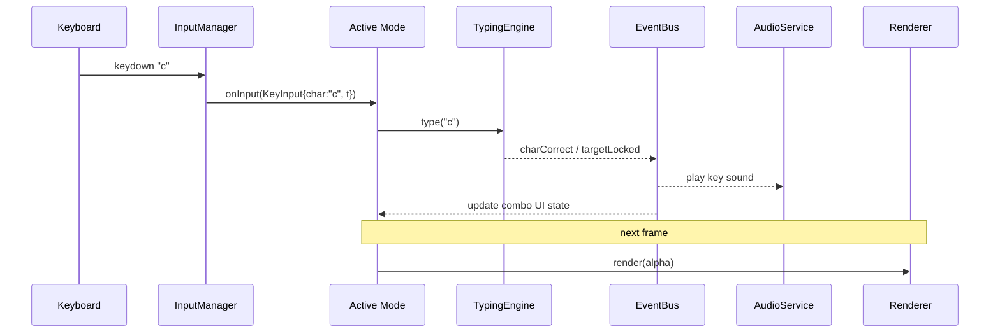

# Architecture

## 1. Overview

Typeverse is a **static, client-only web app**. There is no backend in v1: everything runs in
the browser, data is stored locally, and the site is served from a CDN at
`typeverse.aboubakarisar.tech`.



## 2. Tech stack

| Concern | Choice | Why |
|---|---|---|
| Language | **TypeScript** (strict) | Safety for a growing codebase and contributors |
| Build tool | **Vite** | Fast dev server, code-splitting per mode, small output |
| UI shell | **Preact** + Preact Signals | React-like API at ~4 KB; menus, settings, stats |
| Game rendering | **Canvas 2D** | Simple, fast enough for 2D, no engine lock-in |
| Text rendering in games | DOM overlay for text-heavy modes (Code, Story, Zen) | Crisp text, real fonts, RTL and ligatures for free |
| Audio | **Web Audio API** via **Tone.js** (Type Beats only, lazy-loaded) | Precise timing for rhythm; synths for Free mode |
| Storage | **IndexedDB** via `idb-keyval` | Async, larger than localStorage, survives offline |
| Charts (stats page) | **uPlot** | Tiny and fast |
| Offline / install | `vite-plugin-pwa` (Workbox) | Service worker and manifest |
| Validation | **Zod** | Validate content packs and imported saves |
| Tests | **Vitest** (unit), **Playwright** (end to end) | Fast, same config as Vite |
| Lint/format | ESLint + Prettier | Consistent style |
| Hosting | GitHub Pages or Cloudflare Pages | Free, HTTPS, custom subdomain |
| CI | GitHub Actions | Lint, test, build, deploy on `main` |

## 3. Modules

### 3.1 Core engine (`src/engine`)

| Module | Responsibility |
|---|---|
| `InputManager` | Listens to keyboard on a hidden focused element, handles IME composition, turns raw events into `KeyInput` commands, ignores key repeat when needed. |
| `TypingEngine` | Holds active targets, target lock, per-char comparison, combo, and live metrics. Pure logic with no DOM, so it is fully unit-testable. |
| `MetricsCalculator` | WPM, raw WPM, accuracy, per-key error map, consistency. |
| `GameLoop` | Fixed-timestep update (60 Hz) with variable render; pauses on tab blur. |
| `EventBus` | Typed publish/subscribe for engine and game events. |
| `Rng` | Seeded random generator so runs and daily challenges are reproducible. |

### 3.2 Scene and mode layer (`src/scenes`, `src/modes`)

- `SceneManager` switches between scenes: `Boot`, `Arcade`, `ModeIntro`, `Playing`, `Paused`, `Result`, `Stats`, `Settings`.
- Each mode implements the `GameMode` interface and registers itself in `ModeRegistry`.
- Modes are **dynamically imported** only when chosen.

```ts
export interface GameMode {
  readonly id: ModeId;                 // 'word-rain' | 'type-beats' | ...
  readonly meta: ModeMeta;             // name, color token, description, unlock level
  init(ctx: ModeContext): Promise<void>;   // load assets, set up state
  start(): void;
  update(dt: number): void;            // fixed-step logic
  render(alpha: number): void;         // draw; alpha = interpolation factor
  onInput(input: KeyInput): void;      // forwarded from InputManager
  pause(): void;
  resume(): void;
  getResult(): SessionResult;
  dispose(): void;                     // free memory, stop audio
}

export interface ModeContext {
  canvas: HTMLCanvasElement;
  overlay: HTMLElement;      // for DOM text
  engine: TypingEngine;
  bus: EventBus;
  audio: AudioService;
  content: ContentService;
  settings: Readonly<Settings>;
  rng: Rng;
}
```

### 3.3 Services (`src/services`)

| Service | Responsibility |
|---|---|
| `AudioService` | Unlocks audio on first input, plays SFX from the active sound pack, ducks music, global volumes. |
| `StorageService` | Versioned read/write to IndexedDB; migrations; export/import JSON. |
| `ProgressService` | XP, levels, unlocks, best scores, session history. Listens to `sessionEnd`. |
| `ContentService` | Loads language packs, code packs, stories, charts; validates with Zod; caches. |
| `I18nService` | UI strings, plural rules, text direction. |
| `SettingsService` | Reactive settings (signals); persists changes; applies theme and motion classes. |

## 4. Data flow of one keystroke



## 5. Data model

```ts
interface SaveFile {
  version: number;                       // for migrations
  profile: { name?: string; createdAt: string; xp: number; level: number };
  settings: Settings;
  unlocks: string[];                     // theme and sound-pack ids
  bests: Record<ModeId, { score: number; wpm: number; date: string }>;
  sessions: SessionResult[];             // capped at 100, newest first
  keyStats: Record<string, { hits: number; misses: number }>;
  story: Record<string, { chapter: number; flags: string[] }>;
}

interface SessionResult {
  mode: ModeId;
  date: string;
  durationMs: number;
  score: number;
  wpm: number;
  rawWpm: number;
  accuracy: number;          // 0..1
  maxCombo: number;
  language: string;
  difficulty: Difficulty;
}

interface LanguagePack {
  id: string;                // 'en', 'ur', 'ar'
  name: string;
  dir: 'ltr' | 'rtl';
  font?: string;             // e.g. 'Noto Nastaliq Urdu'
  words: { easy: string[]; normal: string[]; hard: string[]; kid: string[] };
  sentences: string[];
  zen: string[];
  blocklist?: string[];
}
```

## 6. Folder structure

```
typeverse/
├─ public/
│  ├─ icons/                 # app icons, favicon (from logo)
│  ├─ fonts/                 # self-hosted Space Grotesk, JetBrains Mono, Noto
│  └─ audio/                 # sound packs, music (CC0/CC-BY)
├─ content/
│  ├─ languages/en.json  ur.json  ar.json
│  ├─ code/javascript.json  python.json  html.json
│  ├─ stories/the-lost-key/  # story graph JSON
│  └─ charts/                # Type Beats rhythm charts
├─ src/
│  ├─ main.tsx               # bootstraps app
│  ├─ app/                   # App shell, router, SceneManager
│  ├─ engine/                # InputManager, TypingEngine, GameLoop, EventBus, Rng
│  ├─ modes/
│  │  ├─ registry.ts
│  │  ├─ shared/             # FallingEntity, ObjectPool, Hud, Countdown
│  │  ├─ word-rain/
│  │  ├─ type-beats/
│  │  ├─ zombie-survival/
│  │  ├─ typing-racer/
│  │  ├─ code-typer/
│  │  ├─ word-tower/
│  │  ├─ story/
│  │  └─ zen/
│  ├─ services/              # audio, storage, progress, content, i18n, settings
│  ├─ ui/
│  │  ├─ components/         # Keycap, KeycapButton, Panel, Meter, Toast...
│  │  ├─ screens/            # Arcade, Result, Stats, Settings, Pause
│  │  └─ styles/tokens.css   # design tokens (see DESIGN_SYSTEM.md)
│  ├─ i18n/                  # UI string files
│  └─ types/
├─ tests/
│  ├─ unit/                  # engine, metrics, scoring
│  └─ e2e/                   # Playwright: play each mode for 10 s
├─ docs/
├─ .github/workflows/ci.yml
├─ CONTRIBUTING.md
├─ CREDITS.md
├─ LICENSE
└─ package.json
```

## 7. Performance strategy

- Lazy-load each mode and its assets; keep the Arcade bundle small.
- Object pools for falling words, zombies, particles: no allocation inside the game loop.
- Pre-measure word widths once per font and cache.
- Draw static backgrounds to an offscreen canvas once.
- `devicePixelRatio`-aware canvas sizing, capped at 2 for low-end GPUs.
- Pause the loop and audio on `visibilitychange`.

## 8. Deployment

1. GitHub Actions on push to `main`: install → lint → unit tests → build → Playwright smoke test → deploy `dist/`.
2. DNS: add a `CNAME` record `typeverse` → `<username>.github.io` (or Cloudflare Pages target).
3. Add `public/CNAME` containing `typeverse.aboubakarisar.tech`.
4. Enforce HTTPS in the host settings.
5. Security headers (Cloudflare Pages `_headers` file or meta tag): strict CSP with `default-src 'self'`, `Referrer-Policy: no-referrer`, `Permissions-Policy` disabling camera, mic, geolocation.

## 9. Future (v2) backend sketch

When multiplayer and leaderboards arrive: a small Node/Bun server with WebSockets for races,
Postgres for scores, server-side replay validation to prevent cheating, and optional
accounts. The client stays playable offline; online features are additive.

## 10. Implementation notes (deviations from this document)

Two choices in the shipped code differ from the plan above. Both are reversible; raise an issue
if you want them changed back.

| Planned | Shipped | Why |
|---|---|---|
| Tone.js, lazy-loaded for Type Beats | Plain Web Audio oscillators in `services/audio.ts` | The modes only need pitched blips, a pad and offline `.wav` rendering, which `OscillatorNode` and `OfflineAudioContext` already do. It keeps the Type Beats chunk at ~3 KB instead of ~200 KB and ships no audio samples. `AudioService` is still the adapter, so swapping Tone.js back in touches one file. |
| `SceneManager` class | Hash router in `app/router.ts` plus the per-mode state machine in `modes/shared/BaseMode.ts` | The scene list is a URL concern (`#/`, `#/play/<mode>`, `#/stats`, `#/settings`); `intro -> countdown -> playing -> paused -> result` still lives in the documented state machine, enforced by `canTransition()`. |

Session results reach storage exactly as described: a mode emits `sessionEnd` on the event bus,
and `ProgressService` is the only writer of progress. The Play screen subscribes to that event
and hands the result plus the engine's key stats to `ProgressService.record()`.

Fonts are not vendored yet; `tokens.css` fallback stacks are in use. See CREDITS.md.
